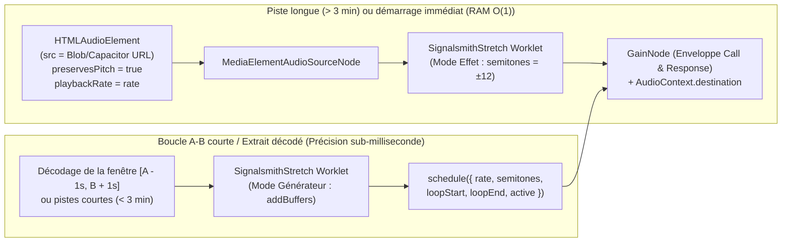
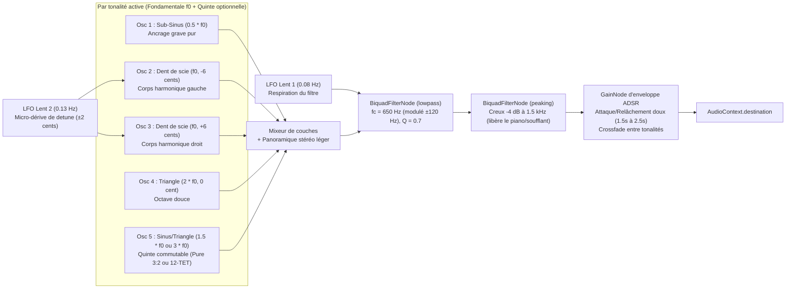

# Briques WebAudio DSP & Gravure de Partition Dynamique (Vite + Capacitor)

Ce document consigne l'évaluation technique sur sources primaires des briques **WebAudio / WebAssembly DSP** et **Gravure Musicale** nécessaires aux **Spec 2** (Métronome *Inner Clock*, Drone harmonique, Studio Audio *Call & Response* avec Time-Stretch/Pitch-Shift), **Spec 3** (**Partition Dynamique**, saisie au clavier virtuel, synthèse de voicings/échantillons piano et **Drills** génératifs) et **Spec 4** (Atelier Ear Training façon *Sonofield*).

Toutes les solutions évaluées répondent à trois contraintes non négociables :
1. **Exécution 100 % hors-ligne** (zéro appel réseau requis en séance ou en **Mode Live**).
2. **Compatibilité WebView Android (Capacitor 8 / Chromium) et navigateurs Desktop** après migration vers **Vite + ES Modules**.
3. **Licence open-source permissive** (MIT, BSD, Apache-2.0 ou MPL-2.0) compatible avec une distribution sur Google Play Store / Apple App Store sans contamination copyleft globale (exclusion du GPL-2.0 strict).

---

## 1. Time-Stretch & Pitch-Shift indépendants 100 % hors-ligne (Studio *Call & Response*)

### 1.1 Besoin fonctionnel (Spec 2)
Dans le **Mode Immersif** ou le **Lecteur de Partition**, le musicien travaillant un relevé ou un accompagnement audio (MP3, WAV, M4A, OGG rattaché à un **Item**) doit pouvoir :
- Faire varier la vitesse (**Time-Stretch**) de **50 % à 150 %** ($0.5\times$ à $1.5\times$) sans altérer la hauteur.
- Transposer (**Pitch-Shift**) de **$\pm 12$ demi-tons** (et ajuster l'accordage fin en cents, ex. $A = 442\text{ Hz}$ ou enregistrements anciens entre deux tons) indépendamment de la vitesse.
- Définir une boucle **A–B** précise au centième de seconde.
- Activer le mode ***Call & Response* (Auto-Gap Loop)** : à la fin de la boucle $[t_A, t_B]$, insérer automatiquement un silence d'une durée proportionnelle $\Delta t_{\text{silence}} = k \cdot \frac{t_B - t_A}{\text{rate}}$ (avec $k \in \{0.5, 1, 2\}$, pendant lequel le clic du métronome peut continuer en option) pour laisser le musicien chanter ou jouer la phrase avant que la boucle ne reparte.
- **Contrainte RAM Android** : éviter qu'un fichier audio de 8 minutes décodé intégralement via `AudioContext.decodeAudioData()` ne bloque le thread principal ou ne sature la mémoire sur un appareil mobile modeste (un fichier stéréo 48 kHz `Float32` de 8 minutes occupe $\approx 184\text{ Mo}$ de RAM PCM brute).

### 1.2 Comparatif factuel des moteurs DSP WebAudio / WebAssembly

| Solution | Algorithme DSP | Licence | Poids du bundle (min + gzip) | Thread d'exécution | Qualité polyphonique ($\pm 12$ demi-tons / $0.5\times$) | Sources primaires |
| :--- | :--- | :--- | :--- | :--- | :--- | :--- |
| **`signalsmith-stretch`** (Geraint Luff) | Vocodeur de phase spectral avancé (STFT multi-résolution + suivi de formants et transitoires) en C++ compilé en WASM | **MIT** | **~45 Ko** (JS + binaire WASM embarqué) | `AudioWorkletProcessor` (thread audio dédié) | **Excellente** : préserve les attaques de batterie/piano et la cohérence de phase polyphonique même à $-12$ demi-tons ou $0.5\times$. | [GitHub `Signalsmith-Audio/signalsmith-stretch`](https://github.com/Signalsmith-Audio/signalsmith-stretch), [npm `signalsmith-stretch`](https://www.npmjs.com/package/signalsmith-stretch), [Documentation technique Signalsmith](https://signalsmith-audio.co.uk/code/stretch/) |
| **`@soundtouchjs/audio-worklet`** (CutterBl / Olli Parviainen) | Temporel **WSOLA** (*Waveform Similarity Overlap-Add*) + interpolation linéaire/cubique en TypeScript pur | **MPL-2.0** (v0.4+) / LGPL-2.1 (anciennes versions) | **~18 Ko** (JS pur, sans WASM) | `AudioWorkletProcessor` (thread audio dédié) | **Moyenne à bonne** : très faible latence et léger en CPU, mais artéfacts de *warbling* / doublage d'attaques perceptibles sous $0.65\times$ ou au-delà de $\pm 5$ demi-tons sur matériau polyphonique dense. | [GitHub `cutterbl/SoundTouchJS`](https://github.com/cutterbl/SoundTouchJS), [npm `@soundtouchjs/audio-worklet`](https://www.npmjs.com/package/@soundtouchjs/audio-worklet) |
| **`rubberband-wasm`** (Breakfast Quay) | Hybride spectral + temporel (*Rubber Band Library* R2/R3 C++ vers WASM) | **GPL-2.0-or-later** (ou licence commerciale payante) | **~180 Ko – 250 Ko** (WASM) | `AudioWorkletProcessor` / Web Worker | **Excellente** (référence studio), mais **incompatible légalement** avec une distribution mobile propriétaire ou App Store sans achat de licence commerciale auprès de Particular Programs Ltd. | [Breakfast Quay Rubber Band Licensing](https://breakfastquay.com/rubberband/), [npm `rubberband-wasm`](https://www.npmjs.com/package/rubberband-wasm) |
| **`tone` (`Tone.GrainPlayer` / `Tone.PitchShift`)** | Synthèse granulaire (`GrainPlayer`) ou ligne à retard fenêtrée (`PitchShift`) sur nœuds WebAudio natifs | **MIT** | **~150 Ko – 200 Ko** (framework Tone.js) | Main thread (ordonnancement des grains) + nœuds natifs | **Insuffisante pour le relevé pro** : effet de *comb filtering*, *phasiness* métallique ou hachage rythmique sur les transitoires rapides de saxophone/piano. | [Documentation Tone.js `PitchShift`](https://tonejs.github.io/docs/latest/classes/PitchShift), [GitHub `Tonejs/Tone.js`](https://github.com/Tonejs/Tone.js) |
| **Hybride Natif `HTMLMediaElement` + `signalsmith-stretch` (Mode Effet)** | Time-stretch natif C++ Chromium (`preservesPitch = true`, WSOLA) + Pitch-shift spectral WASM (`SignalsmithStretch` en mode flux) | **MIT** | **~45 Ko** | Décodage & Time-Stretch en streaming C++ navigateur + `AudioWorklet` pour le Pitch-Shift | **Très bonne et mémoire $O(1)$** : zéro `decodeAudioData` complet en RAM ; lecture instantanée dès la première seconde d'un fichier de 30 minutes. | [MDN `HTMLMediaElement.preservesPitch`](https://developer.mozilla.org/en-US/docs/Web/API/HTMLMediaElement/preservesPitch), [README `signalsmith-stretch`](https://www.npmjs.com/package/signalsmith-stretch) |

### 1.3 Analyse d'architecture : Résoudre le dilemme RAM mobile vs Précision de boucle A–B

La documentation primaire de `signalsmith-stretch` montre que son `AudioWorkletNode` supporte **deux modes de fonctionnement** :
1. **Mode Effet Temps Réel (*Live Input / Effect Mode*)** : On connecte une source WebAudio amont (`sourceNode.connect(stretchNode)`). Le nœud traite le flux continu par blocs avec une latence algorithmique d'environ $40\text{ à }60\text{ ms}$, en appliquant `semitones` (et éventuellement `tonalityHz` / `formantSemitones`).
2. **Mode Générateur / Buffer (*Generator Mode*)** : On alimente le worklet en échantillons `Float32Array` via `stretchNode.addBuffers(channelBuffers)` (qui peut être appelé par tranches successives !), et le worklet gère lui-même la tête de lecture (`input`), la vitesse (`rate`), la transposition (`semitones`) et les boucles exactes (`loopStart`, `loopEnd`) via `stretchNode.schedule({...})`.

Pour éviter toute saturation RAM sur Android tout en ayant un bouclage A–B et un *Call & Response* au sample près :

#### Mécanisme du *Call & Response* (Auto-Gap Loop) sans clic parasite
Que l'on soit en Mode Flux ou en Mode Générateur, l'insertion automatique de silence (*Call & Response*) se pilote par une machine à états couplée au *Lookahead Scheduler* WebAudio :
- **Phase *Call* (Écoute de la référence)** : Durée $D_{\text{call}} = \frac{t_B - t_A}{\text{rate}}$. La piste joue de $t_A$ à $t_B$. À $t_{\text{fin}} - 15\text{ ms}$, une rampe exponentielle/linéaire sur un `GainNode` (`gain.linearRampToValueAtTime(0, t_fin)`) évite tout clic de coupure.
- **Phase *Response* (Silence actif pour l'élève)** : Durée $D_{\text{response}} = k \cdot D_{\text{call}}$ (ex. $k = 1.0$). La lecture est mise en pause (ou `stretch.schedule({ output: t_fin, active: false })`), et la tête de lecture est replacée sur $t_A$. Pendant ce silence, si l'option *« Garder le clic »* ou *« Garder le drone »* est active, le métronome *Inner Clock* continue de battre pour vérifier que l'élève ne presse ni ne ralentit en reproduisant la phrase.
- **Reprise automatique** : À $t_{\text{fin}} + D_{\text{response}}$, la lecture repart à $t_A$ avec une micro-rampe d'attaque de $10\text{ ms}$.

### 1.4 Recommandation tranchée (Question 1)
- **Retenir `signalsmith-stretch` (MIT, ~45 Ko WASM/AudioWorklet)** comme moteur unique de Pitch-Shift / Time-Stretch.
- **Écarter `rubberband-wasm`** (licence GPL-2.0 incompatible sans licence commerciale) et **`Tone.PitchShift`** (qualité acoustique insuffisante sur polyphonie jazz). Garder `@soundtouchjs/audio-worklet` uniquement en repli éventuel si un environnement très ancien bloquait le WASM dans un `AudioWorklet` (ce qui n'est plus le cas sur Android WebView Chromium $\ge 80$).
- **Implémenter l'architecture hybride** :
  1. Lecture en flux immédiat via `HTMLAudioElement` (`preservesPitch = true`, `playbackRate = rate`) chaîné dans `SignalsmithStretch` en **Mode Effet** pour la transposition ($\pm 12$ demi-tons + accordage fin en cents) : **zéro temps d'attente au chargement, consommation RAM constante ($\sim 5\text{ Mo}$) quelle que soit la durée du fichier**.
  2. Pour les boucles A–B courtes nécessitant un rebouclage au sample près (ou les extraits courts $< 2\text{ min}$), alimentation du **Mode Générateur** (`addBuffers`) de `SignalsmithStretch`.

---

## 2. Métronome Jazz Sample-Accurate (*Inner Clock*) & Synthèse de Drone Harmonique (*Sonofield*)

### 2.1 Architecture du Métronome *Inner Clock* : *Lookahead Scheduler* de Chris Wilson

#### Pourquoi `setInterval` / `setTimeout` seuls échouent
Comme démontré par Chris Wilson (W3C Web Audio WG) dans l'article fondateur [*A Tale of Two Clocks — Scheduling Web Audio with Precision*](https://web.dev/articles/audio-scheduling), le thread principal JavaScript subit les pauses du ramasse-miettes (GC), le recalcul du DOM et le rendu du canvas PDF/SVG. Un `setTimeout` pur présente un *jitter* de $10\text{ à }80\text{ ms}$ sur mobile — rédhibitoire pour travailler le placement *afterbeat* (2 & 4) à 200 BPM.

#### Le modèle à deux horloges retenu
1. **Horloge d'ordonnancement (Web Worker ou `setTimeout` récursif à `25 ms`)** :
   - Pour garantir que le métronome et les **Drills** mains-libres ne ralentissent pas même si l'écran subit un rafraîchissement lourd, le timer de réveil ($T_{\text{lookahead}} = 25\text{ ms}$) tourne dans un **Web Worker dédié** (inline via Vite `?worker&inline`) qui envoie un `tick` au thread principal toutes les $25\text{ ms}$.
2. **Fenêtre de pré-programmation (*Schedule Ahead Window* : `100 ms`)** :
   - À chaque `tick`, l'ordonnanceur inspecte l'horloge matérielle `audioContext.currentTime` et programme tous les événements rythmiques dont l'échéance `nextSubdivisionTime` est inférieure à `audioContext.currentTime + 0.100`.
3. **Granularité de subdivision interne** :
   - Pour supporter à la fois le binaire et le swing (croches ternaires ou ratio de swing ajustable de $50\,\%$ à $66.7\,\%$), l'ordonnanceur avance par **pas de double-croche ou de croche de triolet** (ou calcule chaque temps `beatIndex` + l'offset de la croche *upbeat* $\Delta t_{\text{and}} = \text{swingRatio} \times \frac{60}{\text{BPM}}$).
4. **Synchronisation visuelle sans dérive** :
   - Chaque événement audio programmé à `t_audio` est poussé dans une file FIFO `visualQueue.push({ beat, bar, phase, time: t_audio })`.
   - Une boucle `requestAnimationFrame` dépile uniquement les événements où `audioContext.currentTime >= item.time` pour mettre à jour l'indicateur visuel (*Play 4 bars / Silence 2 bars*, flash du temps 1, ou curseur de **Grille**).

#### Modélisation des modes spécifiques *Inner Clock* (Spec 2)
L'ordonnanceur maintient un compteur de mesures `barIndex` et un compteur de temps `beatInBar` ($0 \dots \text{beatsPerBar}-1$) :
- **Mode *2 & 4* (Afterbeat)** :En 4/4, seuls `beatInBar === 1` et `beatInBar === 3` déclenchent un nœud sonore (avec une accentuation hi-hat / rimshot boisé).
- **Mode *« Et » du 4* (Upbeat Resolution de Hal Galper)** : Seule la levée du 4e temps ($t_{\text{beat 4}} + \text{swingRatio} \times \frac{60}{\text{BPM}}$) produit un clic, forçant le musicien à sentir intérieurement la résolution sur le 1er temps muet de la mesure suivante.
- **Mode *Gap Click* ($N$ mesures jouées / $M$ mesures muettes, ou silence aléatoire $p\%$)** :
  - Cycle déterministe : $\text{isSilentBar} = (\text{barIndex} \bmod (N + M)) \ge N$.
  - Pendant les $M$ mesures muettes, aucun clic n'est envoyé à `audioContext.destination` (ou un gain nul est appliqué), mais l'horloge avance strictement afin que le retour du clic sur le temps 1 de la mesure $N+M+1$ révèle immédiatement toute dérive de tempo du musicien.
- **Mode *Tempo Ladder* (Escalier de tempo automatique / *Learning Diamond* de Kenny Werner)** :
  - Toutes les $K$ mesures (ou à la validation d'un palier sans tension), `tempo` est incrémenté de $+\Delta_{\text{BPM}}$ (ex. $+4\text{ BPM}$) jusqu'à $\text{BPM}_{\max}$, en recalculant immédiatement `secondsPerBeat = 60 / tempo` pour la mesure suivante sans interrompre le flux audio.
- **Synthèse du son de clic (Zéro fichier externe requis)** :
  - Combinaison d'un oscillateur percussif court (`triangle` avec pitch-drop rapide de $1200\text{ Hz} \to 280\text{ Hz}$ en $18\text{ ms}$ pour imiter un *woodblock* chaleureux) et d'une salve de bruit blanc filtrée en passe-bande ($3500\text{ Hz}$, $Q = 4$, décroissance exponentielle de $25\text{ ms}$ pour imiter un *stick / charleston fermé*), évitant la fatigue auditive des bips sinusoïdaux purs.

---

### 2.2 Synthèse de Drone Harmonique riche et chaleureux (façon *Sonofield*)

#### Analyse acoustique du bourdon *Sonofield* (Spec 2 & Spec 4)
L'efficacité pédagogique de **Sonofield Ear Trainer** (Max Konyi) repose sur un bourdon de tonique continu dont le spectre harmonique possède trois propriétés :
1. **Ancrage grave stable ($f_0$ et sous-octave $\frac{1}{2}f_0$)** : Donne la sensation physique de gravité tonale.
2. **Richesse en harmoniques naturels ($2f_0, 3f_0, 4f_0, 6f_0$) mais filtrée dans le haut du spectre** : Les harmoniques supérieurs servent de points de repère acoustiques (battements consonance/dissonance) lorsque l'utilisateur joue ou écoute un degré par-dessus, sans jamais masquer la région médium-aiguë ($800\text{ Hz} - 3000\text{ Hz}$) de l'instrument ou des voicings de piano.
3. **Mouvement organique lent (absence de caractère statique/électronique fatiguant)** : Léger désaccordage (*chorusing* en cents) et lente respiration du filtre passe-bas, imitant un orgue indien (*shruti box* / harmonium), un pad analogique chaud ou une section de violoncelles à l'archet.

#### Architecture du graphe WebAudio du Drone (100 % procédural, 0 Ko d'échantillons)

#### Détails d'implémentation clés
- **Juste Intonation vs Tempérament Égal (12-TET) pour la Quinte du Drone** :
  - Lorsque la quinte du bourdon est activée (mode *Tonique + Quinte* type Tanpura/Shruti Box), proposer un commutateur ou utiliser par défaut la **quinte pure ($1.5 \times f_0$, soit $+701.955\text{ cents}$)** pour un verrouillage acoustique sans battement dans le travail d'intonation aux soufflants/chant, ou la **quinte tempérée ($2^{7/12} \times f_0$, soit $+700\text{ cents}$)** pour le travail au piano.
- **Transitions harmonieuses (*Cycle of Fourths* / Changement de tonalité)** :
  - Lorsqu'un **Drill** fait tourner le drone à travers le cycle des quartes toutes les $N$ mesures, ne pas sauter brusquement la fréquence d'un même oscillateur : instancier la nouvelle voix de drone avec un *fade-in* cosinusoïdal/exponentiel de $1.2\text{ s}$ pendant que l'ancienne voix effectue un *fade-out* de $1.5\text{ s}$ avant d'appeler `.stop()`, créant un fondu enchaîné ambient digne de *Sonofield* ou du sas *« Enter the Space »* (Kenny Werner).

---

## 3. Gravure de **Partition Dynamique** & Synthèse d'Accords/Voicings hors-ligne (Spec 3 & Spec 4)

### 3.1 Besoin fonctionnel (Spec 3)
Une **Partition Dynamique** dans **Jazz Trane'R** n'est pas une partition d'orchestre symphonique de 40 portées : il s'agit de **licks**, **patterns**, **voicings à 2 mains (grand staff piano)**, **exercices techniques** ou **lead sheets (mélodie + accords)** comportant typiquement de **1 à 32 mesures**.
Elle doit supporter **deux flux d'entrée** et **trois capacités temps réel** :
1. **Flux A — Saisie directe dans l'application** : Saisie rapide via un clavier piano virtuel tactile, un clavier MIDI ou une mini-syntaxe texte vers un **modèle JSON interne léger**, avec gravure instantanée à chaque note ajoutée.
2. **Flux B — Import `.musicxml` / `.mxl`** : Import d'un relevé ou exercice depuis MuseScore / Sibelius / iReal via le **Trieur Express**.
3. **Capacités temps réel** :
   - **Transposition instantanée dans les 12 tonalités** (et adaptation automatique au profil d'instrument $C, B\flat, E\flat$ et clés de Sol / Fa) avec orthographe enharmonique jazz correcte (ex. éviter des doubles dièses illisibles, respecter l'armure de la tonalité cible).
   - **Curseur temps réel synchronisé au métronome *Inner Clock*** et coloration dynamique des notes jouées/validées.
   - **Mode *Subtraction Drill* (Jerry Bergonzi)** : Masquer ou remplacer à la volée certaines notes d'une cellule par des soupirs ou des têtes de notes fantômes toutes les $N$ mesures.

### 3.2 Comparatif factuel des moteurs de gravure musicale Web

| Critère | **VexFlow (v4 / v5)** | **OpenSheetMusicDisplay (OSMD)** | **Verovio (WASM)** | **alphaTab** |
| :--- | :--- | :--- | :--- | :--- |
| **Rôle architectural** | Moteur de gravure bas niveau (API programmatique directe vers SVG / Canvas) | Surcouche haut niveau au-dessus de VexFlow dédiée au parsing et à la mise en page de fichiers MusicXML complets | Moteur C++ (MEI / MusicXML) compilé en WebAssembly générant du SVG structuré | Moteur C# transpilé en TS/JS orienté tablatures guitare, GP et MusicXML avec synthé intégré |
| **Licence** | **MIT** | **MIT** | **LGPL-3.0** | **LGPL-3.0** |
| **Poids du bundle (min + gzip)** | **~150 Ko** code + **~220 Ko** par police `.woff2` (`Bravura` classique ou `Petaluma` jazz manuscrit) | **~650 Ko – 850 Ko** gzippé (~2,1 Mo minifié non compressé, inclut VexFlow + parseur DOM XML lourd) | **~2,2 Mo – 4,5 Mo** gzippé (~5 à 8 Mo WASM + tables SMuFL embarquées) | **~550 Ko – 750 Ko** gzippé (~1,8 Mo minifié) |
| **Création programmatique (Clavier virtuel / Drills / Bergonzi)** | **Natif et immédiat (< 2 ms)** : on instancie `Stave`, `StaveNote`, `Voice`, `Formatter` directement depuis un objet JSON `{ keys: ['d/4', 'f/4', 'a/4', 'c/5'], duration: 'q' }`. | **Lourd et indirect** : OSMD ne possède pas d'API ergonomique d'édition note-à-note ; il faut sérialiser une chaîne XML complète et relancer `osmd.load(xml)` + `osmd.render()` (~50 à 200 ms). | **Indirect** : nécessite de générer du XML/MEI ou d'utiliser le mode éditeur expérimental via commandes JSON sur le DOM MEI interne. | **Moyen** : possible via la syntaxe texte propriétaire `alphaTex` ou l'arbre d'objets `Score`, mais très typé guitare/tablature. |
| **Import `.musicxml` / `.mxl`** | **Non inclus nativement** (nécessite un convertisseur `MusicXML -> Modèle JSON interne` ou l'utilisation d'OSMD). | **Excellent (Natif)** : supporte `.musicxml` et `.mxl` (zippé), multi-portées, reprises, symboles d'accords. | **Excellent (Natif)** : convertisseur C++ MusicXML $\to$ MEI très complet. | **Bon** : supporte MusicXML, mais l'esthétique par défaut est orientée Guitar Pro. |
| **Curseur temps réel & Coloration de notes** | **Contrôle SVG direct ultra-précis** : chaque `StaveNote` expose `.getBoundingBox()`, `.getAbsoluteX()` et `.setStyle({ fillStyle, strokeStyle })` (ou manipulation CSS directe de l'élément `<g class="vf-stavenote">` dans le SVG). | **Curseur intégré (`osmd.cursor`)** : méthodes `.show()`, `.next()`, `.iterator`, mais moins flexible pour masquer/griser dynamiquement une note sur deux dans un *Drill* de Bergonzi. | **Mapping SVG par ID** : `getElementsAtTime(ms)` retourne les IDs SVG des notes actives. | **Curseur natif intégré** (`playerCursor`), fortement couplé à son propre lecteur MIDI/SoundFont (`alphaSynth`). |
| **Police Jazz (*Real Book* / Manuscrite)** | **Oui (`Petaluma` / `Gonville` / `Bravura`)** via `@vexflow-fonts/petaluma`. | Supporte les polices VexFlow sous-jacentes. | Polices SMuFL (`Bravura`, `Leland`, `Petaluma`). | Polices SMuFL personnalisables. |
| **Sources primaires** | [GitHub `0xfe/vexflow`](https://github.com/0xfe/vexflow), [npm `vexflow`](https://www.npmjs.com/package/vexflow) | [GitHub `opensheetmusicdisplay`](https://github.com/opensheetmusicdisplay/opensheetmusicdisplay), [OSMD Docs](https://opensheetmusicdisplay.org/) | [Verovio Docs](https://www.verovio.org/), [GitHub `rism-digital/verovio`](https://github.com/rism-digital/verovio) | [alphaTab Docs](https://www.alphatab.net/), [GitHub `CoderLine/alphaTab`](https://github.com/CoderLine/alphaTab) |

### 3.3 Pourquoi une représentation pivot JSON + `VexFlow` (avec convertisseur MusicXML $\to$ JSON) surpasse OSMD seul

Si l'on utilisait `OSMD` comme unique moteur en stockant uniquement du XML brut :
- Chaque clic sur le clavier piano virtuel pour ajouter une note à un voicing obligerait à reconstruire un document XML verbeux et à ré-exécuter tout le moteur de mise en page d'OSMD.
- La transposition dans les 12 tonalités, la génération des **24 permutations de Bergonzi** ou le masquage aléatoire de notes (*Subtraction Drill*) seraient lents et complexes à manipuler dans un arbre DOM MusicXML.

À l'inverse, en définissant un **format interne JSON de Partition Dynamique** (`DynamicScoreModel` : mesures, métrique, tonalité de référence, voix Sol/Fa, notes avec hauteur tonale `{ step, alter, octave }` ou degré fonctionnel, durée, liaisons et chiffrages d'accords) :
1. **Saisie au clavier virtuel, Transposition 12 tons et Drills génératifs** opèrent en pur TypeScript sur ce JSON en $< 1\text{ ms}$, puis appellent **`VexFlow` (rendu SVG avec police `Petaluma` ou `Bravura`)** qui grave les 1 à 16 mesures en $< 5\text{ ms}$.
2. **Import `.musicxml` / `.mxl`** : Un parseur MusicXML léger basé sur `DOMParser` natif du navigateur (et `fflate` ~8 Ko pour décompresser les `.mxl`) extrait les mesures, notes, clés, armures, liaisons et harmonies (`<harmony>`) pour les convertir une fois pour toutes lors de l'import dans le `DynamicScoreModel` JSON !
   - *Option complémentaire* : Si l'utilisateur importe une grande partition MusicXML multi-pages complexe (non destinée à être éditée note-à-note mais lue telle quelle), `opensheetmusicdisplay` (qui partage déjà la dépendance `vexflow`) peut être chargé en *lazy-loading* (`import('opensheetmusicdisplay')` découplé par Vite dans un chunk séparé) uniquement à l'ouverture de ce type de fichier.

---

### 3.4 Options légères de synthèse Piano & Voicings 100 % hors-ligne (Spec 3 & Spec 4)

Pour faire entendre un voicing saisi au clavier virtuel, jouer un **Drill** d'accompagnement sur une **Grille**, ou générer les dictées d'**Ear Training** (*Rootless Voicings* Type A/B, accords quartaux, `7alt`, `Maj7#11`), l'application a besoin d'un son de piano acoustique (et éventuellement de piano électrique type Fender Rhodes) réaliste, réactif (latence $< 10\text{ ms}$) et **100 % hors-ligne**.

#### Comparatif des approches d'échantillonnage hors-ligne

| Approche | Licence | Poids du code | Poids des assets audio hors-ligne | Fonctionnement hors-ligne (Capacitor) | Verdict |
| :--- | :--- | :--- | :--- | :--- | :--- |
| **1. Multi-échantillonnage WebAudio natif par tierces mineures (`Opus/WebM` ou `OGG` embarqués)** | **CC0 / Public Domain** (*Splendid Grand Piano*) ou **CC-BY 3.0** (*Salamander Grand Piano v3* d'Alexander Holm) | **~3 Ko** (classe TypeScript interne ~100 lignes sur `AudioBufferSourceNode` + `BiquadFilterNode` + `GainNode`) | **~650 Ko à 1,1 Mo** au total pour 24 échantillons couvrant $A_0 \to C_8$ (1 échantillon tous les 3 demi-tons : $C, E\flat, G\flat, A$) | **100 % natif dans le bundle de l'app** (`public/audio/piano/`) : zéro réseau, chargement en RAM en $< 150\text{ ms}$ au démarrage de l'atelier. | **Recommandé en 1re intention** |
| **2. Librairie `smplr` (Dani Guerrero) + assets locaux** | **MIT** ([GitHub `danigb/smplr`](https://github.com/danigb/smplr)) | **~15 Ko** (min + gzip) | Par défaut télécharge depuis GitHub Pages CDN ; nécessite de rediriger `storage` / `instrumentUrl` vers des fichiers locaux pour le mode 100 % hors-ligne. | Nécessite de packager manuellement les mêmes fichiers audio locaux que l'approche 1 pour éviter tout échec sans connexion. | **Bon**, mais son principal atout (streaming CDN) est inutilisable hors-ligne en caveau. |
| **3. `spessasynth_lib` + fichier SoundFont `.sf3` (Vorbis compressé)** | **Apache-2.0** ([GitHub `spessasus/spessasynth_lib`](https://github.com/spessasus/spessasynth_lib)) | **~90 Ko** (AudioWorklet + parseur SF2/SF3) | **~2,5 Mo à 8 Mo** pour un fichier `.sf3` piano + basse + batterie GM compressé en Ogg Vorbis. | **100 % hors-ligne** (lecture du `.sf3` local en `ArrayBuffer`). Idéal si l'on veut plus tard toute une palette General MIDI (basse acoustique, vibraphone, orgue, batterie). | **Excellente évolution** si l'on souhaite un accompagnement multi-instruments complet. |
| **4. `soundfont-player` (ancien)** | **MIT** | ~20 Ko | Fichiers JS Base64 (`midi-js-soundfonts`) : **+33 % de surpoids Base64**, non maintenu depuis 2018. | Hors-ligne lourd et obsolète. | **Écarté** |

#### Pourquoi l'échantillonnage par tierces mineures ($\pm 1$ demi-ton max) + filtre de vélocité est optimal
Dans la Web Audio API, chaque `AudioBufferSourceNode` possède un `AudioParam` `detune` en cents (1 demi-ton $= 100\text{ cents}$).
- Si l'on embarque dans `public/audio/piano/` **24 échantillons Opus/OGG** (extraits du *Splendid Grand Piano* Public Domain ou du *Salamander Grand Piano* CC-BY 3.0) espacés d'une **tierce mineure** ($C_1, E\flat_1, F\sharp_1, A_1, C_2 \dots A_6, C_7$), toute note MIDI $n \in [21, 108]$ se trouve à une distance maximale de **$\pm 1$ demi-ton** ($\pm 100\text{ cents}$) de l'échantillon le plus proche $r$ :
  $$\text{detune} = (n - r) \times 100\text{ cents}, \quad \text{avec } |n - r| \le 1$$
- À $\pm 1$ demi-ton, la transposition par vitesse de lecture (`detune`) ne produit **aucune déformation de formant perceptible**, tout en divisant par $3$ le nombre de fichiers (24 fichiers de $\sim 35\text{ Ko}$ $= \mathbf{840\text{ Ko}}$ au total).
- **Simulation dynamique de vélocité sans multiplier les couches d'échantillons** : En routant chaque note dans un `BiquadFilterNode` passe-bas dont la fréquence de coupure dépend de la vélocité ($f_c = 800\text{ Hz} + \text{vel}^2 \times 11000\text{ Hz}$) et un `GainNode` avec enveloppe de relâchement douce ($250\text{ ms}$ à l'arrêt de la note), un accord de piano jazz (*Rootless Voicing* ou accord quartal) sonne immédiatement feutré à faible vélocité et brillant sur un accent.

---

## 4. Synthèse des recommandations architecturales pour les Specs 2, 3 et 4

| Brique | Choix technologique retenu | Licence & Poids | Justification synthétique |
| :--- | :--- | :--- | :--- |
| **1. Time-Stretch & Pitch-Shift (Spec 2)** | **`signalsmith-stretch`** (WASM `AudioWorklet`) + architecture hybride (`HTMLAudioElement.preservesPitch` en flux continu pour pistes longues + `addBuffers` pour boucles courtes) | **MIT** (~45 Ko) | Qualité spectrale supérieure à SoundTouchJS sur polyphonie jazz ($\pm 12$ demi-tons), licence MIT sans restriction App Store (contrairement à `rubberband-wasm` en GPL-2.0), et mémoire $O(1)$ sur Android. |
| **2. Métronome *Inner Clock* & Boucle *Call & Response* (Spec 2)** | **Lookahead Scheduler de Chris Wilson** (Worker timer `25 ms` + fenêtre WebAudio `100 ms` + file `requestAnimationFrame` + synthèse percussive boisée procédurale) | **Interne** (0 dépendance, ~4 Ko) | Précision au sample près sur le thread audio matériel, insensible aux ralentissements UI/PDF, support natif du *2 & 4*, du *et du 4*, du *Gap Click* et du *Tempo Ladder*. |
| **3. Drone Harmonique *Sonofield* (Spec 2 & Spec 4)** | **Synthétiseur soustractif multi-oscillateurs WebAudio natif** (Sub-sinus $\frac{1}{2}f_0$ + 2 dents de scie détunées $\pm 6\text{ cents}$ + octave triangle + quinte pure $3:2$ ou 12-TET + filtre passe-bas modulé par LFO à $0.08\text{ Hz}$) | **Interne** (0 dépendance, 0 Ko d'audio) | Chaleur organique continue sans boucle audible, creux spectral à $1.5\text{ kHz}$ laissant respirer l'instrument du musicien, et fondus enchaînés de $1.5\text{ s}$ sur le cycle des quartes. |
| **4. Gravure de Partition Dynamique (Spec 3)** | **`vexflow` (v4/v5)** avec police **`Petaluma`** (jazz) / **`Bravura`** alimenté par un **modèle JSON interne** + convertisseur léger `MusicXML (.musicxml / .mxl) -> JSON` (avec `OSMD` en *lazy-chunk* optionnel uniquement pour les grandes partitions multi-pages non éditables) | **MIT** (~150 Ko code + ~220 Ko police `.woff2`) | Permet à la fois la saisie instantanée au clavier piano virtuel ($< 5\text{ ms}$), la transposition 12 tons, le masquage dynamique de notes (*Subtraction Drill* de Bergonzi), le curseur synchronisé et l'import `.musicxml`. |
| **5. Synthèse Piano & Voicings hors-ligne (Spec 3 & Spec 4)** | **Sampler WebAudio par tierces mineures (24 fichiers Opus/OGG embarqués)** issus de *Splendid Grand Piano* (Public Domain) ou *Salamander Grand Piano* (CC-BY 3.0) avec filtre passe-bas sensible à la vélocité | **Public Domain / CC-BY 3.0** (~850 Ko d'assets audio + ~3 Ko de code) | 100 % hors-ligne dès l'installation, latence $< 5\text{ ms}$, transposition maximale de $\pm 1$ demi-ton par échantillon (zéro artéfact de formant), poids total inférieur à 1 Mo. |

---

## 5. Références primaires

1. **Geraint Luff / Signalsmith Audio** — *Signalsmith Stretch: C++ & WebAudio/WASM Pitch & Time Stretching Library* : [https://github.com/Signalsmith-Audio/signalsmith-stretch](https://github.com/Signalsmith-Audio/signalsmith-stretch) & [Design of a Pitch/Time-Stretcher](https://signalsmith-audio.co.uk/code/stretch/).
2. **Steve "Cutter" Blades / Olli Parviainen** — *SoundTouchJS & `@soundtouchjs/audio-worklet` (MPL-2.0)* : [https://github.com/cutterbl/SoundTouchJS](https://github.com/cutterbl/SoundTouchJS).
3. **Breakfast Quay (Chris Cannam)** — *Rubber Band Audio Time Stretcher and Pitch Shifter Library (Licensing GPL-2.0 vs Commercial)* : [https://breakfastquay.com/rubberband/](https://breakfastquay.com/rubberband/).
4. **Chris Wilson (Google / W3C Web Audio WG)** — *A Tale of Two Clocks — Scheduling Web Audio with Precision*, web.dev : [https://web.dev/articles/audio-scheduling](https://web.dev/articles/audio-scheduling).
5. **MDN Web Docs** — *HTMLMediaElement: `preservesPitch` property & `AudioWorkletNode`* : [https://developer.mozilla.org/en-US/docs/Web/API/HTMLMediaElement/preservesPitch](https://developer.mozilla.org/en-US/docs/Web/API/HTMLMediaElement/preservesPitch).
6. **Mohit Muthanna Cheppudira et al.** — *VexFlow: JavaScript Music Engraving and Tablature (v4/v5, MIT)* : [https://github.com/0xfe/vexflow](https://github.com/0xfe/vexflow).
7. **OpenSheetMusicDisplay (OSMD)** — *MusicXML Renderer based on VexFlow (MIT)* : [https://github.com/opensheetmusicdisplay/opensheetmusicdisplay](https://github.com/opensheetmusicdisplay/opensheetmusicdisplay).
8. **RISM Digital** — *Verovio: Fast, portable and lightweight MEI/MusicXML music notation engraving library (LGPL-3.0)* : [https://www.verovio.org/](https://www.verovio.org/).
9. **Daniel Kuschny** — *alphaTab: Cross-platform music notation and guitar tablature rendering (LGPL-3.0)* : [https://www.alphatab.net/](https://www.alphatab.net/).
10. **Dani Guerrero (`danigb`)** — *`smplr`: Sample-based musical instruments for Web Audio API (MIT)* : [https://github.com/danigb/smplr](https://github.com/danigb/smplr) & *Splendid Grand Piano (Public Domain SFZ samples)* : [https://github.com/sfzinstruments/SplendidGrandPiano](https://github.com/sfzinstruments/SplendidGrandPiano).
11. **Spessasus** — *`spessasynth_lib`: SF2/SF3 SoundFont WebAudio Synthesizer (Apache-2.0)* : [https://github.com/spessasus/spessasynth_lib](https://github.com/spessasus/spessasynth_lib).
